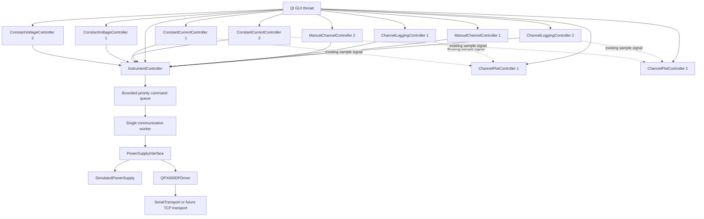

# Proposed application and communication architecture

**Worker, GUI connection and test-engine design.** Current
code implements the entrypoints, dual-channel manual-control GUI, diagnostic logging,
`PowerSupplyInterface`, immutable capabilities, the configurable two-channel
`SimulatedPowerSupply`, the milestone 4 asynchronous simulation lifecycle,
the Milestone 5 `SerialTransport` / `QPX600DPDriver`, the Milestone 6 shared
priority command worker, Milestone 7 per-channel controllers, Milestone 8
independent CSV loggers, Milestone 9 Constant Current state machines, Milestone
10 bounded live-plot models and Milestone 11 Simulation Mode Constant Voltage
state machines. The guarded follow-up connects the physical backend
through that same worker only after an explicit mode, port and Connect action.
See [simulator behaviour](simulator.md).
The remaining design follows the [QPX600DP command reference](qpx600dp_commands.md).

## Ownership and data flow

The Milestone 6 `InstrumentCommandWorker` evolves the milestone 4 lifecycle
owner in place. It creates, connects, identifies, uses and disconnects the
selected simulator or explicit-port backend on one dedicated Python thread. Its bounded submission API uses a
priority queue with FIFO sequence numbers, command tickets and optional
cancellation keys. The GUI receives immutable state and command outcomes through
queued Qt signals. Connection or identification failure attempts cleanup,
releases the backend reference and permits retry with a fresh instance.
Application shutdown cancels queued work, wakes the worker and performs a bounded
join; it never terminates a thread unsafely.

The selected backend is instantiated, connected, used and disconnected only by
the communication worker.
There is one worker and one instrument session per
physical unit, shared by both channel engines. The simulator uses the same queue
and public interface. CSV files remain per channel and per explicit logging run,
independent of the selected transport.

| Component | Responsibilities | Excluded responsibilities |
| --- | --- | --- |
| MainWindow / reusable ChannelPanel | Compose widgets, collect validated requests, show states and measurements | No serial I/O, protocol loops or waiting on futures |
| InstrumentController | Submit typed actions, own session/channel generations, coordinate cancellation and faults | No direct transport access from calling threads |
| InstrumentCommandWorker | Execute bounded actions, maintain query/reply pairing, return results/errors | No protocol dwell, plotting or disk logging |
| QPX600DPDriver | Validate channels/current range, query the existing voltage range, encode the Milestone 5 command subset, parse exact values/units/status, expose capabilities | No GUI, scheduling, implicit range change, reset, lock or output action on connect |
| SerialTransport | Open an explicit port, apply 9600/8N1/XON-XOFF, serialize one LF/CRLF transaction, invalidate uncertain sessions | No port enumeration or knowledge of CC, CV, CSV or cell area |
| ConstantCurrentController, one per channel | Own explicit state, active monotonic time, queue requests, measured results and either a local CSV or an active logger sink | No backend reference, shared-port access, second writer for an active logger or GUI widgets |
| TestProtocol implementations | Generate planned steps and averaging rules | No GUI, serial handles or wall-clock sleeps |
| SafetyValidator | Validate full protocol against software and documented hardware capability before Start | No silent clamping or device writes |
| ChannelLoggingController / CsvLogFile, one per channel | Monotonic scheduling through the shared queue; exclusive creation, CSV rows, flush/close and file errors | No direct backend, plot buffer or software diagnostic logging |
| ChannelPlotController / ChannelPlotPanel, one per channel | Consume existing measurement signals, retain bounded/downsampled display points, coalesce repaints and render voltage/current | No queue submission, backend access, CSV ownership or output control |
| ConstantVoltageController / panel, one per channel | Specialize the Milestone 9 state machine for Simulation Mode target voltage/current limit operation | No direct backend, extra polling, duplicate CSV writer or Real Hardware enablement |

Milestone 7 instantiates two `ManualChannelController` objects in the Qt thread.
They share the same `ConnectionController` and therefore the same worker/backend.
Each validates user text before submission, assigns a channel cancellation key,
tracks one pending request ID, and accepts only its matching result. A queued
callable performs a selected mutation (if any) and a complete channel read-back
without yielding the shared worker, so another channel cannot interleave a
query/response. Backend errors preserve the last successful display, fault and
disable only the affected channel, and leave Refresh available for explicit
recovery. Connection loss clears both displays to a disabled, unknown state.

`ChannelPanel` owns presentation only. It shows programmed voltage, current
limit, measured voltage/current, voltage range and output state. Output On needs
an explicit confirmation dialog and Output Off uses the queue's safety priority.
Neither widget nor manual controller creates a backend, transport or thread.

Milestone 8 adds two `ChannelLoggingController` objects in the Qt thread. A
single-shot precise timer schedules each channel independently, but every
complete read-back is one `BACKGROUND` queue operation. Only one logger request
per channel can be pending, so queries cannot overlap or interleave. Completed
read-backs may update the corresponding manual display, but the logger never
receives or calls the backend directly.

Sample deadlines are anchored to the start monotonic clock. Deadlines passed
while a request is pending are counted as missed and are not replayed in a
burst; scheduling resumes at the next future slot. UTC timestamps are recorded
separately. Files use Windows-safe UTC names, exclusive `x` creation, one header,
per-row flush and deterministic close. Disconnect and shared-session failure
stop both loggers. Directory, permission, disk/write, malformed-result or local
sample failure stops only that channel unless the connection itself fails.
Reconnect requires an explicit new Start and therefore a new file.

Milestone 9 treats an already-active same-channel `ChannelLoggingController` as
the single CSV owner. The protocol appends annotated rows through that controller
on the Qt main thread and does not construct or close another writer. Its own
measurement requests remain atomic `BACKGROUND` queue work alongside the logger's
read-only requests. Pause/Resume retains the sink. Stop/completion detaches from
an operator-started logger without stopping it; loss or file failure of the sink
drives the protocol through its normal bounded Output-Off failure cleanup.

Milestone 10 connects both existing per-channel `sample_received` paths to one
`ChannelPlotController` per channel. Plot controllers run in the Qt thread and
perform no measurement scheduling: logger and protocol requests remain the only
sources of backend reads. Each controller timestamps signal receipt with a
monotonic display clock, tags points with the connection session generation and
coalesces snapshot notifications to at most 10 Hz. The custom Qt canvas draws
voltage against a left V axis and current against a right A axis over elapsed
seconds. Session changes break line segments without erasing history.

Display storage is bounded at 2,000 points per channel. Progressive decimation
retains representative history plus the first and newest points; full-resolution
CSV rows are unaffected because plotting is a downstream consumer. Clear resets
only the selected display model. Malformed samples or paint failures update plot
status and never call logging, protocol, queue or output-control APIs.

Milestone 11 reuses the same state-machine implementation for Constant Voltage.
Its public inputs map target voltage and current limit to the shared validated
setting/preflight operations, while its CSV identity is `constant_voltage` and
its queue/cancellation keys are distinct. Only one protocol may own a channel;
the other channel remains independent. CV samples feed the same logger sink and
plot signal as Constant Current, so no second writer or measurement poll exists.
The CV panel is unavailable outside Simulation Mode.

The connection controller defaults to Simulation Mode. Real Hardware selection
requires a warning acknowledgement and a manually typed `COM<N>` name; neither
action constructs a backend or opens a port. Only explicit Connect lets the
worker call the selected factory. The worker then opens the named port,
identifies the model, reads CH1 completely and reads CH2 completely as one
connection initialization operation. Only a QPX600DP with two successful
read-backs reaches CONNECTED, so channel controls cannot become active on a
partial session. Candidate cleanup closes the transport after open, identity or
read failure. There is no port enumeration, probing, automatic retry or
automatic reconnect.

The initial physical command order is `*IDN?`, followed for each channel by
`VRANGE<N>?`, `V<N>?`, `I<N>?`, `V<N>O?`, `I<N>O?` and `OP<N>?`. All are
queries. Connect/disconnect never reset, set voltage/current/range or alter an
output. Subsequent reads and writes use the same queue as the simulator. Real
Output On displays channel, programmed voltage and current limit in a stronger
confirmation; Output Off remains available at safety priority. Any asynchronous
real command failure closes the shared session and requires manual recovery.

## Threads and scheduling

Milestone 6 uses one Python communication thread with `queue.PriorityQueue`.
Milestone 9/11 protocol state machines and single-shot timers remain in the Qt main
thread and submit only bounded backend operations; they do not add engine threads.
Milestone 10 plot buffers, coalescing timers and canvases also stay in the Qt main
thread and add no worker. The Qt GUI stays on the main thread;
typed Qt signals deliver immutable snapshots back to its slots. Signal delivery
must be queued across threads. Do not call a widget from any worker or wait for
I/O in a GUI callback.

Each engine owns its state machine and uses monotonic time for active test time
and dwell deadlines. It may wait on a condition/event or a bounded command future
in its own thread. CH1 waiting 30 seconds at a polarisation point consumes no
communication-worker time; CH2 continues to receive its own measurements and
setpoint changes. UTC-aware wall timestamps are recorded separately.

The implemented instrument abstraction exposes connect/disconnect/identify,
set_voltage/current, output_on/off, read_voltage/current, read_set_voltage/current,
read_output_state, read_voltage_range, capabilities and is_connected. Status-event support will be
added with the physical driver without inventing instantaneous mode readbacks.
is_connected
means session health, not proof of recent communication or output safety.
Drivers receive an injected transport; engines receive controller access, never
the driver's serial object. Store capabilities centrally in a frozen dataclass
populated from the manual's evidence, not repeated numeric literals in widgets.
Milestone 3 implements this in `instrument/capabilities.py`; the shared constant
is immutable, while every simulator instance owns separate channel state and RNGs.

All connection and command work runs off the GUI thread through the same worker.
Milestone 6 adds request IDs, FIFO sequence metadata, command futures, explicit
priorities and cancellation keys; Milestone 7 uses them for manual controls,
Milestone 8 uses `BACKGROUND` priority with independent cancellation keys for
logging, and Milestones 9/11 use normal atomic state transitions, safety-priority
Output Off and background sampling. Milestone 10 consumes their returned samples
without queue submission. Session generations are recorded in each CSV row.
Run generations and cross-channel telemetry fairness remain engine-level
work for later milestones. No direct-serial GUI callbacks are acceptable.

## Transaction, cancellation and fairness rules

Every queued action carries a request ID, session generation, channel/run
generation where applicable, priority, FIFO sequence number and completion future.
Bound queued work and in-flight requests per channel; reject overload visibly.
Coalesce redundant display-only refresh requests, never silently discard required
experiment samples. Fair dispatch between channels prevents telemetry starvation.

A query write and its complete reply form one indivisible transport transaction.
Consume replies from `IFLOCK` and `IFUNLOCK` as well as `?` commands. Only one
owner reads destructive status registers, distributing cached timestamped events
to both engines. Keep transactions short. V/I readback pairs should be adjacent
when practical and carry acquisition timestamps; do not claim simultaneous ADC
sampling. Normal setters should be checked using readback and error status at
appropriate transaction boundaries before an engine assumes success.

Before dispatching each write, the worker atomically validates its generation
and reserves the action as in-flight under a short lock. Never hold that lock
during I/O. A cancellation invalidates all older affected actions; late replies
may complete their transport transaction but cannot revive an old engine run.
Check cancellation between setup writes, especially before output ON. A long
multi-command start sequence must not prevent OFF dispatch at short boundaries.

Suggested priority order: global emergency OFF; channel OFF/cancellation;
connection/fault recovery; scheduled setpoints/measurements; optional UI refresh.
Priority cannot interrupt bytes already on the wire or a command inside the
instrument's sequential parser. Avoid voltage-with-verify commands (up to 5 s)
in normal operation; use host-side settling waits. Bound both read and write
timeouts, including the case where flow control prevents a write from finishing.

An ordinary validation error fails that request without damaging healthy queued
work. Timeout, partial response or malformed framing creates an uncertain
transaction boundary: invalidate the shared session, stop both engines and
reject stale queued commands. Do not let a late reply become the next query's
answer, blindly retry an output-on write or auto-resume a timed experiment.
Recovery must explicitly re-establish framing and ownership with outputs off.

## State, pause, stop and shutdown

The implemented Constant Current enum is `IDLE`, `STARTING`, `RUNNING`,
`PAUSING`, `PAUSED`, `RESUMING`, `STOPPING`, `COMPLETED` and `FAILED`. Only its
channel controller changes this state. Later protocols may add separate outcomes;
Emergency behavior remains deferred.

| Request/event | Required transition or result |
| --- | --- |
| Connect and complete shared initialisation | Protocol remains IDLE; real mode also requires exact QPX600DP identity and successful initial readback |
| Validate full protocol and reserve file | IDLE/terminal to STARTING |
| Confirm OFF, apply verified settings and enable selected output | STARTING to RUNNING |
| Pause | Cancel pending sample; RUNNING to PAUSING; confirm output OFF; then PAUSED |
| Resume | PAUSED to RESUMING; recheck session/OFF/settings; confirm one Output On; then RUNNING |
| Stop | RUNNING/PAUSED/transition to STOPPING; send channel OFF; finalise CSV; then COMPLETED |
| Finish | Confirm channel OFF and finalise data, then COMPLETED |
| Failed I/O, failed OFF or failed required data write | ERROR, with physical output unknown unless verified |
| Start while running / resume while not paused | Controlled rejection; no new worker or duplicate experiment |

**Pause means output OFF and active protocol time frozen.** Record pause/resume
events and continue appropriately paced monitoring. Preserve wall time separately
from active elapsed time. A policy enum can permit other pause behaviour later;
no alternative is silently enabled. WAIT and OUTPUT_OFF custom steps will need
explicit output semantics before milestone 15 validation is accepted.

Channel Stop never emits `OPALL`, changes CONFIG, resets the instrument or
invalidates the other channel's generation. Global emergency first latches the
controller and invalidates both runs, then requests `OPALL 0`, explicit `OP1 0`
and `OP2 0` as appropriate, and reads back both states where communication permits.
An OFF failure for one output must not prevent attempting the other. Retain data
and display a conspicuous unresolved fault if shutdown cannot be verified.

Disconnect and application exit coordinate a deliberate session shutdown:
invalidate work, request/confirm both outputs OFF, finalise loggers, release the
interface lock and close the port, then join workers. The GUI remains responsive
while waiting and reports any unconfirmed output. Do not rely on destructor
order, daemon-thread termination, LOCAL or `*RST` for shutdown.

The manual documents no communications watchdog. Software cannot guarantee OFF
after USB loss, OS crash or loss of PC power; lab-level shutdown provisions must
cover that gap. Session loss affects both channels; a channel-specific file or
protocol fault should stop only its own output if the transport is still healthy.

## Protocols, safety, data and plotting

Constant Current, Constant Voltage and bounded time plots are implemented. Later
milestones add staircase voltage sweep, current sweep, polarisation and custom sequence. Use explicit V, A, s, cm2
and A/cm2 fields internally. Convert `I = j * area` at the boundary, reject
non-finite values, and validate every step before arming. Scheduling and final
polarisation-window averaging must be testable with a fake monotonic clock.

Keep immutable hardware capabilities separate from user-configured safety limits.
`QPX600DP_CAPABILITIES` records 80 V, 50 A and 600 W ratings; none is an
experiment default. `UserSafetyLimits` is a separate optional simulation object,
and future persistent configuration must require explicit operator values rather
than copying the hardware maxima.

Milestone 9 uses separate Simulation and Real Hardware Constant Current policy
objects, currently both 10 V, 5 A, 50 W, at most 24 hours and intervals from 0.1
through 3600 seconds. Real Start/Resume additionally require a detailed explicit
authorization and a two-stage queued preflight. The second stage rechecks the
session, OFF state and settings immediately before one Output-On attempt. A stale
or duplicate request cannot cross that boundary. Physical protocol acceptance is
not implied by fake-serial validation.

Apply basic capability/output safeguards before the first real manual control;
milestone 16 completes the safety system, rather than postponing every safeguard
until then. Validate voltage/current, their programming grids and worst-case
setpoint/compliance power. Issue 14 states guaranteed points of 10 V / 50 A and
80 V / 7.5 A but gives no complete equation for the graph. The current simulator
therefore uses a documented conservative segment: at most 50 A through 10 V and
at most 7.5 A above 10 V through 80 V, plus the 600 W ceiling. It deliberately
does not interpolate or assume `600 / V` and may reject usable physical points.
Keep user limits lower as required for each experiment. Recheck measured power
and trip events while running.

Each channel writes rows continuously through its own logger. Files use exclusive
creation and Windows-safe timestamp names. Each row is flushed immediately;
flushing is not a guarantee against sudden power loss. File errors stop only the
affected logger and never command an output or change any instrument setting.
The logger records an error row only when the file remains writable and never
invents a successful error row.

Retain full data on disk. Implemented plotting receives existing sample signals
and retains at most 2,000 downsampled display points per channel. Display reset
does not pause or alter engines, loggers or CSV output. Snapshot/repaint delivery
is coalesced at 10 Hz. Polarisation summary writes occur at each
completed step and use only the measured final averaging window.

## Milestone boundaries and acceptance

Milestones 1-4 remain historical checkpoints created under the original CPX400DP
assumption. The post-Milestone-4 model correction retargeted current code and
documentation to QPX600DP without rewriting those commits. Milestone 5 adds an
offline-tested physical driver and explicit-port transport but deliberately does
not connect them to the GUI. Milestone 6 integrates a shared priority command
queue into the existing single-owner boundary without adding a second backend
owner. Milestone 7 adds manual control and a guarded explicit-port follow-up;
Milestone 8 adds queue-fed CSV logging, Milestone 9 adds Constant Current,
Milestone 10 adds bounded plotting and Milestone 11 adds Simulation Mode Constant Voltage
protocols without port discovery, plotting or global emergency control. Its
guarded Real Hardware follow-up is fake-serial tested, and supervised resistor-load
functional acceptance later passed on both channels. Electrolyser and unattended
use remain unapproved pending transient assessment and later safety milestones.
Milestone 7 real-hardware GUI acceptance and Milestone 8 read-only hardware
logging acceptance are complete. Milestones 10/11 add Simulation Mode validated
live plots and Constant Voltage without extra polling or another worker. Later protocol types remain
out of scope.
Later concurrency tests must cover cancellation just before ON, stale replies,
interleaved queries, independent channel shutdown and in-flight emergency latency.
Logging tests cover unwritable files, interruption and bounded in-flight work.
Windows hardware and 24-hour accelerated simulator acceptance belong to their
specified later milestones; they are not claimed by the current test suite.
