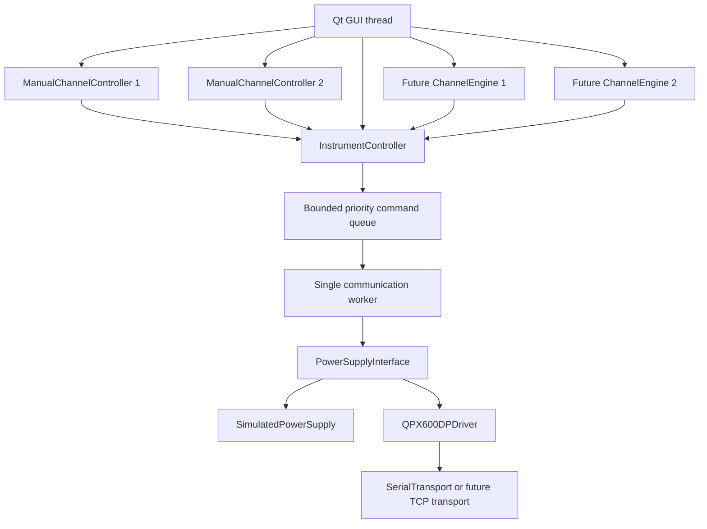

# Proposed application and communication architecture

**Worker, GUI connection and test-engine design.** Current
code implements the entrypoints, dual-channel manual-control GUI, diagnostic logging,
`PowerSupplyInterface`, immutable capabilities, the configurable two-channel
`SimulatedPowerSupply`, the milestone 4 asynchronous simulation lifecycle,
the Milestone 5 `SerialTransport` / `QPX600DPDriver`, the Milestone 6 shared
priority command worker and Milestone 7 per-channel controllers. The physical
backend has no Qt dependency and is not yet connected to the GUI worker.
See [simulator behaviour](simulator.md).
The remaining design follows the [QPX600DP command reference](qpx600dp_commands.md).

## Ownership and data flow

The Milestone 6 `InstrumentCommandWorker` evolves the milestone 4 lifecycle
owner in place. It creates, connects, identifies, uses and disconnects the
simulator on one dedicated Python thread. Its bounded submission API uses a
priority queue with FIFO sequence numbers, command tickets and optional
cancellation keys. The GUI receives immutable state and command outcomes through
queued Qt signals. Connection or identification failure attempts cleanup,
releases the backend reference and permits retry with a fresh instance.
Application shutdown cancels queued work, wakes the worker and performs a bounded
join; it never terminates a thread unsafely.

The selected backend is instantiated, connected, used and disconnected only by
the communication worker.
There is one worker and one instrument session per
physical unit, shared by both channel engines. The simulator uses the same queue
and public interface. One writer per physical connection remains mandatory even
when transport changes.

| Component | Responsibilities | Excluded responsibilities |
| --- | --- | --- |
| MainWindow / reusable ChannelPanel | Compose widgets, collect validated requests, show states and measurements | No serial I/O, protocol loops or waiting on futures |
| InstrumentController | Submit typed actions, own session/channel generations, coordinate cancellation and faults | No direct transport access from calling threads |
| InstrumentCommandWorker | Execute bounded actions, maintain query/reply pairing, return results/errors | No protocol dwell, plotting or disk logging |
| QPX600DPDriver | Validate channels/current range, query the existing voltage range, encode the Milestone 5 command subset, parse exact values/units/status, expose capabilities | No GUI, scheduling, implicit range change, reset, lock or output action on connect |
| SerialTransport | Open an explicit port, apply 9600/8N1/XON-XOFF, serialize one LF/CRLF transaction, invalidate uncertain sessions | No port enumeration or knowledge of CC, CV, CSV or cell area |
| ChannelEngine, one per channel | Own state transitions, protocol time, local logger and measured results | No shared-port access |
| TestProtocol implementations | Generate planned steps and averaging rules | No GUI, serial handles or wall-clock sleeps |
| SafetyValidator | Validate full protocol against software and documented hardware capability before Start | No silent clamping or device writes |
| DataLogger, one per channel | Exclusive creation, CSV rows, metadata, flush/sync/close and file errors | No plot buffer or software diagnostic logging |

Milestone 7 instantiates two `ManualChannelController` objects in the Qt thread.
They share the same `ConnectionController` and therefore the same worker/backend.
Each validates user text before submission, assigns a channel cancellation key,
tracks one pending request ID, and accepts only its matching result. A queued
callable performs a selected mutation (if any) and a complete channel read-back
without yielding the shared worker, so another channel cannot interleave a
query/response. Backend errors preserve the last successful display, fault and
disable only the affected channel, and leave Refresh available for explicit
recovery. Connection loss clears both displays to a disabled, unknown state.

`ChannelPanel` owns presentation only. It shows programmed voltage, current
limit, measured voltage/current, voltage range and output state. Output On needs
an explicit confirmation dialog and Output Off uses the queue's safety priority.
Neither widget nor manual controller creates a backend, transport or thread.

## Threads and scheduling

Milestone 6 uses one Python communication thread with `queue.PriorityQueue`.
Future protocol milestones add one interruptible engine thread per channel. The Qt GUI stays on the main thread;
typed Qt signals deliver immutable snapshots back to its slots. Signal delivery
must be queued across threads. Do not call a widget from any worker or wait for
I/O in a GUI callback.

Each engine owns its state machine and uses monotonic time for active test time
and dwell deadlines. It may wait on a condition/event or a bounded command future
in its own thread. CH1 waiting 30 seconds at a polarisation point consumes no
communication-worker time; CH2 continues to receive its own measurements and
setpoint changes. UTC-aware wall timestamps are recorded separately.

The implemented instrument abstraction exposes connect/disconnect/identify,
set_voltage/current, output_on/off, read_voltage/current, read_set_voltage/current,
read_output_state, read_voltage_range, capabilities and is_connected. Status-event support will be
added with the physical driver without inventing instantaneous mode readbacks.
is_connected
means session health, not proof of recent communication or output safety.
Drivers receive an injected transport; engines receive controller access, never
the driver's serial object. Store capabilities centrally in a frozen dataclass
populated from the manual's evidence, not repeated numeric literals in widgets.
Milestone 3 implements this in `instrument/capabilities.py`; the shared constant
is immutable, while every simulator instance owns separate channel state and RNGs.

All connection and command work runs off the GUI thread through the same worker.
Milestone 6 adds request IDs, FIFO sequence metadata, command futures, explicit
priorities and cancellation keys; Milestone 7 uses them for two-channel manual
controls.
Session/run generations and cross-channel telemetry fairness remain engine-level
work for later milestones. No direct-serial GUI callbacks are acceptable.

## Transaction, cancellation and fairness rules

Every queued action carries a request ID, session generation, channel/run
generation where applicable, priority, FIFO sequence number and completion future.
Bound queued work and in-flight requests per channel; reject overload visibly.
Coalesce redundant display-only refresh requests, never silently discard required
experiment samples. Fair dispatch between channels prevents telemetry starvation.

A query write and its complete reply form one indivisible transport transaction.
Consume replies from `IFLOCK` and `IFUNLOCK` as well as `?` commands. Only one
owner reads destructive status registers, distributing cached timestamped events
to both engines. Keep transactions short. V/I readback pairs should be adjacent
when practical and carry acquisition timestamps; do not claim simultaneous ADC
sampling. Normal setters should be checked using readback and error status at
appropriate transaction boundaries before an engine assumes success.

Before dispatching each write, the worker atomically validates its generation
and reserves the action as in-flight under a short lock. Never hold that lock
during I/O. A cancellation invalidates all older affected actions; late replies
may complete their transport transaction but cannot revive an old engine run.
Check cancellation between setup writes, especially before output ON. A long
multi-command start sequence must not prevent OFF dispatch at short boundaries.

Suggested priority order: global emergency OFF; channel OFF/cancellation;
connection/fault recovery; scheduled setpoints/measurements; optional UI refresh.
Priority cannot interrupt bytes already on the wire or a command inside the
instrument's sequential parser. Avoid voltage-with-verify commands (up to 5 s)
in normal operation; use host-side settling waits. Bound both read and write
timeouts, including the case where flow control prevents a write from finishing.

An ordinary validation error fails that request without damaging healthy queued
work. Timeout, partial response or malformed framing creates an uncertain
transaction boundary: invalidate the shared session, stop both engines and
reject stale queued commands. Do not let a late reply become the next query's
answer, blindly retry an output-on write or auto-resume a timed experiment.
Recovery must explicitly re-establish framing and ownership with outputs off.

## State, pause, stop and shutdown

Planned per-channel enum: DISCONNECTED, IDLE, READY, RUNNING, PAUSED, STOPPING,
COMPLETED, ERROR. A separate outcome records COMPLETED, STOPPED, EMERGENCY or
ERROR; emergency remains visibly latched. Only an engine changes its own state.

| Request/event | Required transition or result |
| --- | --- |
| Connect and complete shared initialisation | DISCONNECTED to IDLE |
| Validate full protocol, reserve files and obtain Start confirmation | IDLE to READY |
| Apply verified initial setpoints and enable selected output | READY to RUNNING |
| Pause | Invalidate pending channel actions; confirm that output OFF succeeded; RUNNING to PAUSED |
| Resume | Restore validated previous setpoints and output state; PAUSED to RUNNING after confirmation |
| Stop | Invalidate channel actions; RUNNING/PAUSED to STOPPING; send channel OFF; finalise its data; return IDLE with STOPPED outcome |
| Finish | Confirm channel OFF and finalise data, then COMPLETED |
| Failed I/O, failed OFF or failed required data write | ERROR, with physical output unknown unless verified |
| Start while running / resume while not paused | Controlled rejection; no new worker or duplicate experiment |

**Pause means output OFF and active protocol time frozen.** Record pause/resume
events and continue appropriately paced monitoring. Preserve wall time separately
from active elapsed time. A policy enum can permit other pause behaviour later;
no alternative is silently enabled. WAIT and OUTPUT_OFF custom steps will need
explicit output semantics before milestone 15 validation is accepted.

Channel Stop never emits `OPALL`, changes CONFIG, resets the instrument or
invalidates the other channel's generation. Global emergency first latches the
controller and invalidates both runs, then requests `OPALL 0`, explicit `OP1 0`
and `OP2 0` as appropriate, and reads back both states where communication permits.
An OFF failure for one output must not prevent attempting the other. Retain data
and display a conspicuous unresolved fault if shutdown cannot be verified.

Disconnect and application exit coordinate a deliberate session shutdown:
invalidate work, request/confirm both outputs OFF, finalise loggers, release the
interface lock and close the port, then join workers. The GUI remains responsive
while waiting and reports any unconfirmed output. Do not rely on destructor
order, daemon-thread termination, LOCAL or `*RST` for shutdown.

The manual documents no communications watchdog. Software cannot guarantee OFF
after USB loss, OS crash or loss of PC power; lab-level shutdown provisions must
cover that gap. Session loss affects both channels; a channel-specific file or
protocol fault should stop only its own output if the transport is still healthy.

## Protocols, safety, data and plotting

Introduce protocols in the requested order: CC, time plots, CV, staircase voltage
sweep, current sweep, polarisation, custom sequence. Use explicit V, A, s, cm2
and A/cm2 fields internally. Convert `I = j * area` at the boundary, reject
non-finite values, and validate every step before arming. Scheduling and final
polarisation-window averaging must be testable with a fake monotonic clock.

Keep immutable hardware capabilities separate from user-configured safety limits.
`QPX600DP_CAPABILITIES` records 80 V, 50 A and 600 W ratings; none is an
experiment default. `UserSafetyLimits` is a separate optional simulation object,
and future persistent configuration must require explicit operator values rather
than copying the hardware maxima.

Apply basic capability/output safeguards before the first real manual control;
milestone 16 completes the safety system, rather than postponing every safeguard
until then. Validate voltage/current, their programming grids and worst-case
setpoint/compliance power. Issue 14 states guaranteed points of 10 V / 50 A and
80 V / 7.5 A but gives no complete equation for the graph. The current simulator
therefore uses a documented conservative segment: at most 50 A through 10 V and
at most 7.5 A above 10 V through 80 V, plus the 600 W ceiling. It deliberately
does not interpolate or assume `600 / V` and may reject usable physical points.
Keep user limits lower as required for each experiment. Recheck measured power
and trip events while running.

Each channel writes rows continuously through its own engine/logger. Reserve
unique files using exclusive creation and sanitised Windows-safe names, including
reserved names. Write companion metadata before enabling the output. Flush each
row or a small bounded batch; add periodic fsync with a documented durability
interval. Flushing is not a guarantee against sudden power loss. Surface file
errors, command channel OFF independently of disk cleanup, and mark ERROR in the
CSV/metadata if a write remains possible. Never invent a successful error row.

Retain full data on disk. Plotting receives bounded snapshots through signals,
with at most 5,000-20,000 retained display points per channel. Pause-plot affects
only display refresh. Engines and loggers continue. Do not enqueue one unbounded
Qt signal per acquisition if the GUI cannot keep up; report overload and use
bounded/coalesced display snapshots. Polarisation summary writes occur at each
completed step and use only the measured final averaging window.

## Milestone boundaries and acceptance

Milestones 1-4 remain historical checkpoints created under the original CPX400DP
assumption. The post-Milestone-4 model correction retargeted current code and
documentation to QPX600DP without rewriting those commits. Milestone 5 adds an
offline-tested physical driver and explicit-port transport but deliberately does
not connect them to the GUI. Milestone 6 integrates a shared priority command
queue into the existing single-owner boundary without adding a second backend
owner. Milestone 7 adds simulation-only manual control without exposing the
physical driver, serial-port selection, protocols, logging, plotting or global
emergency control. Protocols remain later work.
Later concurrency tests must cover cancellation just before ON, stale replies,
interleaved queries, independent channel shutdown and in-flight emergency latency.
Later data tests must cover unwritable files, interruption and bounded memory.
Windows hardware and 24-hour accelerated simulator acceptance belong to their
specified later milestones; they are not claimed by the current test suite.
