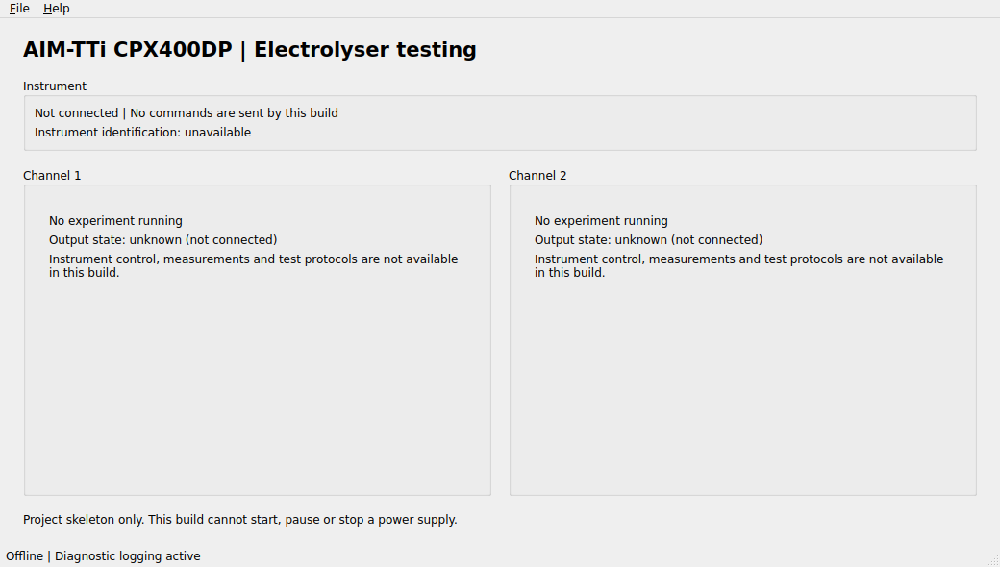

# Milestone 1 verification

Date: 2026-09-08. Target: source-based Windows application skeleton.
Execution environment: Linux x86-64, CPython 3.12.13, PySide6 / Qt 6.10.1,
pytest 9.0.2. No Windows desktop or physical CPX400DP was available.

## Checks completed

| Check | Result |
| --- | --- |
| `python -m pytest -q` from project root | 8 passed in 1.25 s |
| Script entrypoint launched from another working directory | Passed |
| `python -m cpx_electrolyser` | Passed |
| Real Qt event loop, visible window, timed close | Passed for both entrypoints |
| Unicode text and paths containing spaces | Passed |
| Immediate diagnostic flush and append across sessions | Passed |
| Diagnostic rotation retains five older segments | Passed |
| Duplicate logging setup rejected; root handlers untouched | Passed |
| Unwritable log target returns controlled failure; existing file retained | Passed |
| Default project paths independent of working directory | Passed |
| `python -m compileall -q main.py cpx_electrolyser tests` | Passed |
| Installed package dependency check | Passed |
| Standalone `main.py --smoke-test --screenshot ...` | Exit code 0 |
| Visual inspection of captured Qt window | Passed; no clipped text |

The first GUI runs could not import Qt Widgets because this minimal Linux
workspace lacked `libEGL.so.1`. An isolated copy of Ubuntu's verified `libegl1`
package resolved that environment issue. No application bypass or test skip was
introduced. This Linux runtime dependency is not needed as a separate Windows step.

The smoke-test timer is only a test exit mechanism, not a protocol scheduler.
There is no instrument access, simulator, background command worker or data
acquisition in this milestone. The application does not claim that physical
outputs are off.

## Captured window

This image was rendered using Qt's offscreen platform plugin. Native Windows
fonts, scaling, window decorations and interaction still require the
[Windows smoke procedure](../../tests/manual_smoke_test.md).
